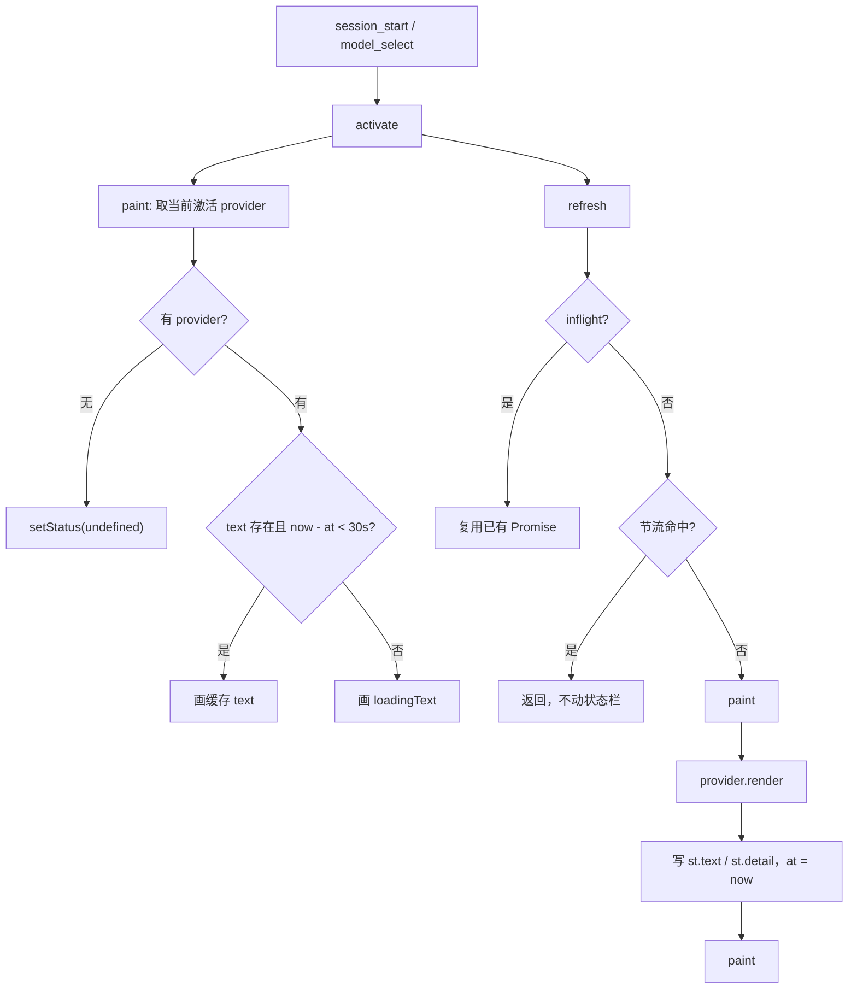

# pi-show-provider-quota 实现计划

把现行的 `pi-show-minimax-quota` 与 `pi-show-opencode-go-quota` 合并为一个新的扩展包 `pi-show-provider-quota`。合并后只要在 provider 登记表里加一项，就能支持新的大模型厂商订阅额度，不再需要新开 npm 包。

## 背景

两个旧包的架构完全同构，逐文件对应：

| 文件           | 作用                                                         |
| -------------- | ------------------------------------------------------------ |
| `index.ts`     | 事件接线与斜杠命令                                           |
| `line.ts`      | 状态栏控制器（门控、并发去重、节流、占位符、快照、状态写入） |
| `api.ts`       | 额度 HTTP 客户端                                             |
| `auth.ts`      | 凭据解析                                                     |
| `aggregate.ts` | 接口响应归一化                                               |
| `format.ts`    | 状态行与明细的字符串拼装                                     |

差异集中在三处，都应下沉到 provider 内部：

- 接口端点、超时、HTTP 失败分类不同。
- 响应数据结构与百分比语义不同。
- 状态栏布局与文案不同。

其它部分（控制器状态机、`formatDuration`、颜色桶）完全一致，应当共享。

## 决策记录

以下为已确认的决策，实现时不得回退：

1. 新包名 `pi-show-provider-quota`，版本从 `0.1.0` 开始，单扩展入口 `src/index.ts`。
2. 单个 status key `provider-quota`，单个斜杠命令 `/show-provider-quota`。
3. 状态存于 `Map<provider.id, ProviderState>`；只有唯一的 `paint` 出口，且只画当前激活 provider 的那一格。
4. 删除 `#generation` 计数器。它在单出口设计下不再必要。
5. 节流统一 30 秒，每个 provider 各自记录时间戳与 inflight。
6. 百分比全链路统一为已用（used）。MiniMax 用 `100 - remaining` 换算，OpenCode 直接取接口值。颜色阈值统一为 `<70` 绿、`<90` 黄、`>=90` 红。
7. 布局与文案由各 provider 自己拼装，core 不共享状态行模板。
8. 同 provider 内换模型为空操作；切到不受支持的 provider 清空状态栏但保留缓存。
9. 失败占位符同样进 Map 缓存。
10. 缓存与刷新规则：`now - at < 30 秒` 且有缓存则画缓存且不发请求，否则画 loading 并（在节流允许时）发请求。
11. 明细命令：有缓存且未过期则直接打印缓存，否则取最新；若当前有请求在飞，先提示查询中并等待其结束。
12. 旧两个包的源码与已发布版本保留，README 标注 deprecated 并引导到新包。

## 术语：provider 对象

"provider" 指一个普通的配置对象，把某个厂商的"怎么鉴权、怎么查、怎么拼状态行"收拢在一起。它取代的是"一个厂商一个 npm 包"，不引入新的架构层。

```ts
export interface QuotaProvider {
  id: string; // "minimax-cn" / "opencode-go"
  providerIds: readonly string[]; // 归它管的 model provider，允许一对多
  loadingText(ctx: ExtensionContext): string; // 缓存过期或无缓存时显示的 dim 文案
  /** 所有已知失败都必须在内部变成占位符文本并返回，不抛异常 */
  render(ctx: ExtensionContext, now: number): Promise<RenderResult>;
}
```

登记和查找只做两件事：一个数组，加一个 `Array.find`。没有 class、没有容器、没有注册副作用。

注意别和 pi 宿主的 `ctx.modelRegistry` 混淆——那是宿主自己的对象，用来按 provider 取 API key。为避免重名，这里不叫 registry，`PROVIDERS` 与 `providerFor` 都放在 `src/providers/index.ts`，与它们操作的 provider 模块放在一起：

```ts
// src/providers/index.ts
import { minimax } from "./minimax/index.ts";
import { opencodeGo } from "./opencode-go/index.ts";

export const PROVIDERS: QuotaProvider[] = [minimax, opencodeGo];

export function providerFor(
  providers: readonly QuotaProvider[],
  providerId: string | undefined,
): QuotaProvider | undefined {
  if (!providerId) return undefined;
  return providers.find((p) => p.providerIds.includes(providerId));
}
```

core 不认识厂商名、不认识 HTTP、不认识 `percent`，只通过 `render` 调用 provider。它由 `src/index.ts` 通过构造函数拿到 `PROVIDERS`，不直接 import 具体厂商。

## 包结构

```plaintext
packages/pi-show-provider-quota/
├── package.json
├── biome.json
├── tsconfig.json
├── .npmignore
├── LICENSE
├── README.md
├── AGENTS.md
├── PLAN.md
├── src/
│   ├── index.ts
│   ├── core/
│   │   ├── types.ts
│   │   ├── format.ts
│   │   ├── lookup.ts
│   │   └── line.ts
│   └── providers/
│       ├── index.ts
│       ├── minimax/
│       │   ├── index.ts
│       │   ├── api.ts
│       │   ├── auth.ts
│       │   ├── aggregate.ts
│       │   └── format.ts
│       └── opencode-go/
│           ├── index.ts
│           ├── api.ts
│           ├── auth.ts
│           ├── aggregate.ts
│           └── format.ts
└── tests/
    ├── core/
    │   ├── format.test.ts
    │   ├── lookup.test.ts
    │   └── line.test.ts
    ├── index.test.ts
    ├── providers/
    │   ├── minimax/
    │   │   ├── api.test.ts
    │   │   ├── auth.test.ts
    │   │   ├── aggregate.test.ts
    │   │   └── format.test.ts
    │   └── opencode-go/
    │       ├── api.test.ts
    │       ├── auth.test.ts
    │       ├── aggregate.test.ts
    │       └── format.test.ts
    └── helpers/
        ├── expect.ts
        ├── theme.ts
        ├── fake-provider.ts
        ├── models.ts
        └── usage.ts
```

## core 契约

### 类型

```ts
export interface RenderResult {
  text: string; // 状态栏内容，已上主题色
  detail?: string; // 明细纯文本，仅成功时存在
}

interface ProviderState {
  text?: string; // 上次落定内容，数据帧或失败占位符
  detail?: string; // 上次落定的明细
  at: number; // 上次请求落定的时刻，0 表示从未请求
  inflight?: Promise<void>; // 存 Promise 而非布尔，命令可 await
}
```

### 状态机



### 行为规则

`paint(ctx)` 是唯一写状态栏的入口：

```ts
#paint(ctx) {
  if (!ctx.hasUI) return;
  const provider = providerFor(this.#providers, ctx.model?.provider);
  if (!provider) {
    ctx.ui.setStatus(STATUS_KEY, undefined);
    return;
  }
  const st = this.#stateFor(provider.id);
  const fresh = st.text !== undefined && this.#now() - st.at < THROTTLE_MS;
  ctx.ui.setStatus(STATUS_KEY, fresh ? st.text : provider.loadingText(ctx));
}
```

- `activate(ctx)`：先 `paint`，再 `refresh`。用于 `session_start` 与 `model_select`。`paint` 无条件执行，保证切换到有缓存的 provider 时立即换行，不残留上一家的内容。
- `refresh(ctx)`：`inflight` 去重 → 节流判断（命中则直接返回且不 `paint`，避免闪烁）→ `paint` → `provider.render` → 写状态 → `finally` 更新 `at`、清 `inflight`、`paint`。
- `isFetching(ctx)` / `isFresh(ctx)`：分别回答“该 provider 是否有请求在飞”与“缓存是否在 30 秒内”，供命令决定是等待、直接打印还是拉取；两者都不修改状态。
- 无激活 provider 时 `paint` 清行；`#state` 缓存保留，切回即可命中。
- 同一 provider（含两侧都为 undefined）在 `model_select` 中直接返回，不 `paint`、不发请求。
- 每个 provider 的 `at` 与 `inflight` 相互独立，两家可并行请求。

`render` 的异常兜底在 core 层，仅负责"不向宿主抛错"，不生成厂商文案：

```ts
try {
  const r = await provider.render(ctx, now);
  st.text = r.text;
  st.detail = r.detail;
} catch {
  // provider 本不该抛。保持原有内容/清行，绝不向宿主抛错。
  st.text = undefined;
  st.detail = undefined;
} finally {
  st.at = this.#now();
  st.inflight = undefined;
  this.#paint(ctx);
}
```

不设 `errorText` 接口成员：每个 provider 只有一份 `"…: error"` 文案，位于 `render` 内部（MiniMax 对应 `fetchQuota` 返回 `null` 的分支，OpenCode 对应 `res.kind === "error"` 的分支）。

### 共享工具

`src/core/format.ts`：

- `formatDuration(ms)`：`<1h` → `3m`；`<1d` → `2h35m`；`>=1d` → `5d8h`（丢分钟）；`<=0` → `0m`。
- `pctColor(theme, usedPct)`：`<70` 绿、`<90` 黄、`>=90` 红。

## provider 迁移映射

| 来源                                           | 去向                                              | 改动                                                                                           |
| ---------------------------------------------- | ------------------------------------------------- | ---------------------------------------------------------------------------------------------- |
| minimax `api.ts`                               | `providers/minimax/api.ts`                        | 原样（5s 超时、`model_remains`、失败归 `null`）                                                |
| minimax `auth.ts`                              | `providers/minimax/auth.ts`                       | 原样（同步 `readStoredCredential`、`sk-api-` → `wrong-type`）                                  |
| minimax `aggregate.ts`                         | `providers/minimax/aggregate.ts`                  | 语义改：`used = clamp(0, 100, 100 - remaining)`；时长字段不变                                  |
| minimax `format.ts`                            | `providers/minimax/format.ts`                     | 布局改为 `MPlan·<5h pct>(<dur>)·<7d pct>(<dur>)`(无标签按位置)，改从 core 引工具               |
| minimax `line.ts` 占位符                       | `providers/minimax/index.ts`                      | `loadingText` 与 `render` 内的占位符分支原样搬                                                 |
| minimax `line.ts` 控制器                       | `core/line.ts`                                    | 通用化，删全局 `#inflight`                                                                     |
| opencode `api.ts` / `auth.ts` / `aggregate.ts` | 同名迁入                                          | 原样                                                                                           |
| opencode `format.ts`                           | `providers/opencode-go/format.ts`                 | 布局不变，改从 core 引工具，删本地阈值常量                                                     |
| opencode `line.ts`                             | `core/line.ts` + `providers/opencode-go/index.ts` | `classifyModelSwitch` → core 的 provider 身份比较；`#generation` 删；节流与快照逻辑改写进 core |
| 两包 `tests/helpers/expect.ts`、`theme.ts`     | `tests/helpers/`                                  | 逐字符相同，直接共用                                                                           |

MiniMax 需新增 `formatDetail`（`MiniMax Token Plan usage (used %)` 加 `5h` / `7d` 两行）与 `api.test.ts`（当前缺失）。

## index.ts 接线

```ts
const line = new QuotaLine(PROVIDERS);

pi.on("session_start", (_event, ctx) => {
  if (ctx.hasUI) line.activate(ctx);
});

pi.on("agent_settled", (_event, ctx) => {
  if (ctx.hasUI) void line.refresh(ctx);
});

pi.on("model_select", (event, ctx) => {
  if (!ctx.hasUI) return;
  const transition = classifyModelSwitch(
    PROVIDERS,
    event.previousModel?.provider,
    event.model?.provider,
  );
  if (transition === "noop") return;
  line.activate(ctx);
});
```

命令 `/show-provider-quota` 的判定顺序：

1. 无激活 provider，提示警告，不动状态栏。
2. 该 provider 有 `inflight`，提示"查询中"并 `await` 它。
3. 有缓存且 `now - at < 30s`，直接打印 `st.detail`。
4. 否则 `refresh`（此时必然通过节流检查），有 `detail` 则打印，无则提示失败且不打印旧数据。

## 测试计划

core（用 `tests/helpers/fake-provider.ts` 注入可控 `render`，时钟可注入）：

- 单一 paint：切 P→Q 后 P 的在飞结果落定，状态栏仍为 Q。
- 节流：`<30s` 命中缓存不发请求；`>=30s` 先 loading 再发请求。
- 失败占位符进缓存：`<30s` 切回直接重现；`>=30s` 切回 loading 并重试。
- 每个 provider 独立的 inflight：P、Q 可并行；同 provider 重复触发去重。
- 无激活 provider 清行但缓存保留，切回即现。
- 同 provider 切换不 `paint`、不请求。
- `activate` 在有缓存时不闪 loading。
- 命令：缓存新鲜时不请求；过期时请求后打印；无缓存时请求；在飞时等待后打印。
- `render` 抛错时保持不向外抛。
- `formatDuration` 边界与 `pctColor` 的 69 / 70 / 89 / 90。

providers：

- 登记表：`providerFor` 的 `providerIds` 一对多映射，以及未命中时返回 `undefined`。
- MiniMax：remaining → used 换算与 clamp、取首模型、缺字段归 0；auth 三态；api 的 200 / 非 2xx / 网络异常 / 非 JSON / 空数组；format 的完整行与 detail。
- OpenCode：现有 `aggregate` / `auth` / `api` / `format` 用例迁移；保留 `oauth`、空 key、401、403 等边界。

## 文档与发布

- 新包 `README.md`（安装、激活、各 provider 的窗口表、状态消息表、命令说明、30s 节流）与 `AGENTS.md`。
- 根 `README.md` 的 Packages 表新增一行，两个旧包标注 deprecated。
- 根 `AGENTS.md` 的项目速览与目录结构同步新包。
- 两个旧包 `README.md` 顶部加 deprecation 横幅，引导 `pi install npm:pi-show-provider-quota`。
- changeset：新包初始 `0.1.0` 手工写入；旧包 README 改动可各出一个 patch intent（可选）。
- `.npmignore` 排除 `tests/`、`PLAN.md` 等非发布内容（`package.json` 的 `files` 已白名单 `src/`、`README.md`、`LICENSE`）。

## 分阶段落地

1. 脚手架：`package.json`、`biome.json`、`tsconfig.json`、`LICENSE`、`.npmignore`。
2. core：`types.ts`、`format.ts`、`line.ts` 与 core 测试（含 fake provider）。
3. MiniMax provider 与测试。
4. OpenCode Go provider 与测试。
5. `index.ts` 接线与命令测试。
6. 文档、旧包 deprecated 标注、changeset。
7. 根目录 `pnpm verify` 全绿；`pi -e ./packages/pi-show-provider-quota` 手工冒烟（两家 provider 各切换一次并各跑一次命令）。

## 已知风险

- MiniMax 状态栏展示从"剩余"变为"已用"，数值与颜色在剩余 30% 至 50% 区间会与旧包不同。这是决策 6 的预期结果。
- 旧包若与新包同时安装，同一 provider 会出现两行（status key 不同）。旧包 deprecated 后不再演进，接受此风险。
- MiniMax 的 `100 - remaining` 若接口返回非整数，换算后可能出现小数百分比；按已用原值直接展示，不做四舍五入。
